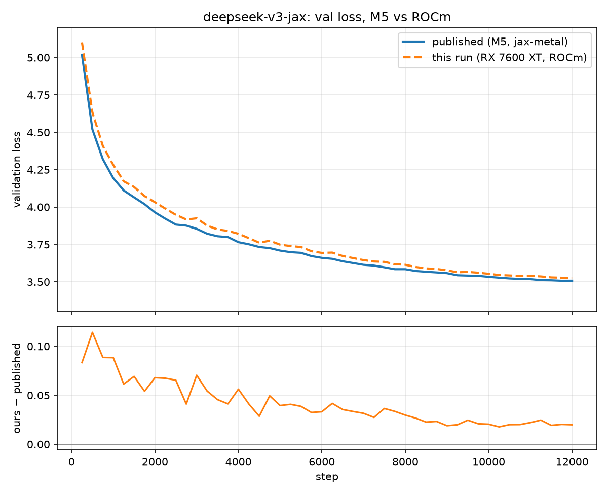

# Running on AMD GPUs (ROCm)

This folder runs the unmodified training code on an AMD Radeon GPU under Linux, using JAX's ROCm
backend inside a container. Nothing ROCm-related needs to be installed on the host. It was tested
on an RX 7600 XT (16 GB, gfx1102). Other RDNA2/3/4 cards should work, possibly without the
overrides described below.

## Tested setup

| | |
|---|---|
| GPU | AMD Radeon RX 7600 XT, 16 GB (Navi 33, gfx1102), PCIe 4.0 x8 |
| CPU / RAM | Ryzen 5 5600X (6c/12t), 64 GB |
| OS | Fedora Linux 45 Workstation, kernel 7.3.3 |
| GPU driver | In-kernel `amdgpu` + Fedora `amd-gpu-firmware` 20261019 (no AMD DKMS, no host ROCm) |
| Container | rootless podman 6.1.3 |
| Image | `docker.io/rocm/jax:rocm10.1.0_ubuntu24.04_py3.12_jax_release_0.11.1` (ROCm 10.1, JAX 0.11.1, Python 3.12) |

The built image is about 18 GB. The GPU device nodes (`/dev/kfd`, `/dev/dri/renderD*`) must be
accessible to your user. On Fedora they are by default. On other distros you may need to add your user to the
`render` and `video` groups.

## Quick start

```bash
podman build -t dsv3-jax-rocm -f rocm/Containerfile rocm

rocm/run.sh python -c "import jax; print(jax.devices())"   # [RocmDevice(id=0)]
rocm/run.sh python smoke_metal.py                           # backend-agnostic despite the name
JAX_PLATFORMS=cpu rocm/run.sh pytest tests.py -q            # 39 passed (also passes on the GPU)

# Data: either rebuild it, or download the exact published bytes (see the main README)
rocm/run.sh python prepare_data.py

rocm/run.sh python train.py                                 # main run, ~50 min on an RX 7600 XT
DETACH=1 NAME=dsv3-main rocm/run.sh python train.py --out runs/main   # same, in the background

rocm/run.sh python sample.py --prompt "The fog came in off the" --num 3
rocm/run.sh python rocm/compare.py                          # compare against the published run
```

`rocm/run.sh` mounts the repo at `/work` and passes through the GPU. SELinux labelling is disabled for the
container so the device nodes and bind mount work on Fedora.

## The three settings that matter

All three are set in `rocm/Containerfile`:

1. **`HSA_OVERRIDE_GFX_VERSION=11.0.0`**. JAX's ROCm wheels are built for gfx1030/1100/1101/1200/1201
   and the Instinct parts, but not gfx1102 (RX 7600 / 7600 XT). This setting makes the runtime treat the
   card as gfx1100. `11.0.1` also works. Remove it on a card that is already a build target.
2. **`XLA_FLAGS=--xla_gpu_enable_triton_gemm=false`**. With XLA's Triton GEMM fusions enabled, the
   default config fails on Navi 33 with `HSA_STATUS_ERROR_INVALID_DISPATCH_PARAMETERS` /
   `ROCM_ERROR_LAUNCH_OUT_OF_RESOURCES` and the GPU hangs. The tests (tiny config) don't trigger it.
   Disabling Triton GEMM routes matmuls to hipBLASLt/rocBLAS.
3. **`JAX_THREEFRY_PARTITIONABLE=false`**. JAX 0.5 changed this PRNG default, so on newer JAX
   `jax.random.key(0)` gives different initial weights than the `jax==0.4.34` used for the published
   run. With it set, the CPU backend reproduces the published step-25 loss exactly (10.765). This only
   matters for exact replication.

## Results vs. the published M5 run



| | MacBook Air M5 (jax-metal) | RX 7600 XT (ROCm) |
|---|---|---|
| Median throughput | 10.7k tok/s | **35.0k tok/s** |
| 12k-step wall time | ~2.6 h | **~50 min** |
| Val loss @ 250 / 1000 / 6000 | 5.018 / 4.193 / 3.660 | 5.102 / 4.282 / 3.693 |
| Final val loss @ 12000 | 3.507 | **3.527** |
| Ablation @ 2000, bias on / off | 3.921 / 3.923 | 3.999 / 4.014 |
| Expert load @ 2000, bias on | 5.7–6.9 % | 5.4–6.8 % |
| Expert load @ 2000, bias off | 0.09–18.6 % | 0.07–18.0 % |

The main run used the same published data bytes (hashes verified) but JAX 0.11's default PRNG, because the
`JAX_THREEFRY_PARTITIONABLE` setting was added afterwards. The ablations used the old PRNG. The load-balancing
result reproduces closely: with the bias, every expert stays near the even 6.25 %, and without it the load
collapses onto a few experts.

All 13 checks in `smoke_metal.py` pass on ROCm, including "grad through 2-axis contraction", which
fails on jax-metal. bf16 matmul throughput is about 24 TFLOP/s.

### About the gap

The ROCm runs sit consistently above the M5 curve early (+0.08 to +0.11 val loss in the first ~2k
steps, across three runs with two different inits). The gap then shrinks steadily to +0.02 at the end.
`rocm/numerics.py` compares one forward and backward pass on the CPU and GPU backends with identical
inputs:

- **float32: CPU and GPU agree.** Same loss, gradient relative error about 1e-6.
- **bf16 mixed precision (as trained): both backends are about equally far from the exact gradient.**
  The error is 3–12 % per parameter group, with the MoE router largest, and the GPU slightly lower in
  every group. ROCm is not computing less accurately. It rounds differently from CPU/Metal, and the
  high-learning-rate early phase amplifies that.

Why the M5 trajectory comes out slightly ahead early, and stays ahead, isn't pinned down. A full
CPU-backend run would settle whether it's specific to ROCm, but it would take about a day on a 6-core CPU (~1.2k tok/s).

## Files

- `Containerfile`: AMD's JAX image plus the repo's non-JAX dependencies and the three settings above.
- `run.sh`: runs a command in the container with the GPU and repo mounted (`DETACH=1` for long runs).
- `compare.py`: downloads the published `metrics-*.jsonl` from release v1.0 and compares them against
  `runs/{main,bias_on,bias_off}`, then writes `figures/val_compare.png`.
- `numerics.py`: CPU vs GPU loss and gradient check on the first batch (f32 and bf16).
